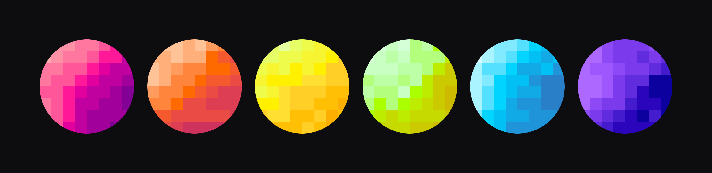

<h1 align="center">pixel planets</h1>

<p align="center">
  
</p>

<p align="center">
  <b>Pixel-Avatare für Agenten. Neuer Name, neue Welt.</b>
</p>

<p align="center">
  <a href="README.md">🇬🇧 English</a> | <a href="README.ru.md">🇷🇺 Русский</a> | <b>🇩🇪 Deutsch</b>
</p>

---

## Verwendung

```bash
python pixel_planets.py --name yolo --color "#FF1999" --out avatar.svg
```

SVG braucht nichts weiter. Für PNG `pip install pillow` ausführen und `--out avatar.png` verwenden.

| Option    | Standard     | Beschreibung                       |
| --------- | ------------ | ---------------------------------- |
| `--name`  | `yolo`       | Seed, Agentenname oder Schlüssel   |
| `--color` | `#FF1999`    | Grundfarbe als HEX                 |
| `--out`   | `avatar.png` | Ausgabedatei, `.svg` oder `.png`   |
| `--size`  | `512`        | Größe in Pixeln                    |

Als Bibliothek:

```python
from pixel_planets import make_avatar, save_svg

cells = make_avatar("<public-key>", "#FF1999")
save_svg(cells, "avatar.svg", size=256)
```

## Wie es funktioniert

Der Name wird mit sha256 gehasht und bestimmt das Layout. Der Verlauf wird in OKLCH um deine Farbe herum aufgebaut, und jede der 8×8 Zellen nimmt eine Stufe daraus.

## Anpassung

`GRID` ist die Rastergröße, `STEPS` die Anzahl der Verlaufsstufen (ungerade lassen), `drop` in `make_palette` legt den Kontrast fest.