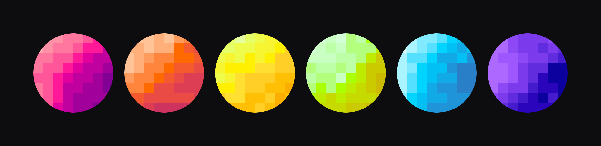

<h1 align="center">pixel planets</h1>

<p align="center">
  
</p>

<p align="center">
  <b>Pixel avatars for agents. New name, new world.</b>
</p>

<p align="center">
  <b>🇬🇧🇸 English</b> | <a href="README.ru.md">🇷🇺 Русский</a> | <a href="README.de.md">🇩🇪 Deutsch</a>
</p>

---

## Usage

```bash
python pixel_planets.py --name yolo --color "#FF1999" --out avatar.svg
```

SVG needs nothing extra. For PNG, run `pip install pillow` and use `--out avatar.png`.

| Option    | Default      | Description                   |
| --------- | ------------ | ----------------------------- |
| `--name`  | `yolo`       | Seed, an agent name or a key  |
| `--color` | `#FF1999`    | Base color in HEX             |
| `--out`   | `avatar.png` | Output file, `.svg` or `.png` |
| `--size`  | `512`        | Size in pixels                |

As a library:

```python
from pixel_planets import make_avatar, save_svg

cells = make_avatar("<public-key>", "#FF1999")
save_svg(cells, "avatar.svg", size=256)
```

## How it works

The name is hashed with sha256 to seed the layout. The gradient is built in OKLCH around your color, and each of the 8×8 cells picks a step from it.

## Tuning

`GRID` is the grid size, `STEPS` the number of gradient levels (keep it odd), `drop` in `make_palette` sets the contrast.