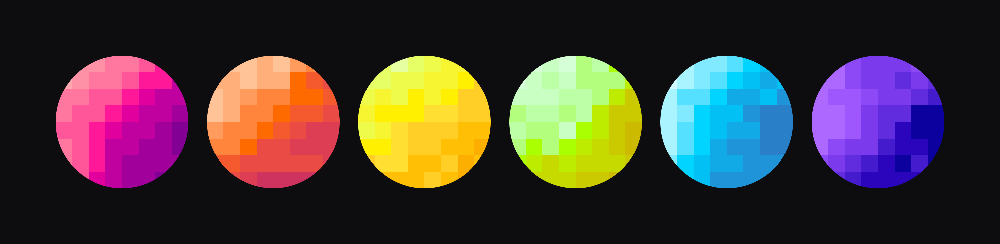

<h1 align="center">pixel planets</h1>

<p align="center">
  
</p>

<p align="center">
  <b>Пиксельные аватарки для агентов. Новое имя — новый мир.</b>
</p>

<p align="center">
  <a href="README.md">🇬🇧 English</a> | <b>🇷🇺 Русский</b> | <a href="README.de.md">🇩🇪 Deutsch</a>
</p>

---

## Использование

```bash
python pixel_planets.py --name yolo --color "#FF1999" --out avatar.svg
```

Для SVG больше ничего не нужно. Для PNG выполните `pip install pillow` и укажите `--out avatar.png`.

| Опция     | По умолчанию | Описание                          |
| --------- | ------------ | --------------------------------- |
| `--name`  | `yolo`       | Сид, имя агента или ключ          |
| `--color` | `#FF1999`    | Базовый цвет в HEX                |
| `--out`   | `avatar.png` | Файл на выходе, `.svg` или `.png` |
| `--size`  | `512`        | Размер в пикселях                 |

Как библиотека:

```python
from pixel_planets import make_avatar, save_svg

cells = make_avatar("<public-key>", "#FF1999")
save_svg(cells, "avatar.svg", size=256)
```

## Как это работает

Имя хешируется через sha256 и задаёт раскладку. Градиент строится в OKLCH вокруг вашего цвета, и каждая из клеток сетки 8×8 берёт из него свой шаг.

## Настройка

`GRID` задаёт размер сетки, `STEPS` число уровней градиента (оставляйте нечётным), `drop` в `make_palette` контраст.